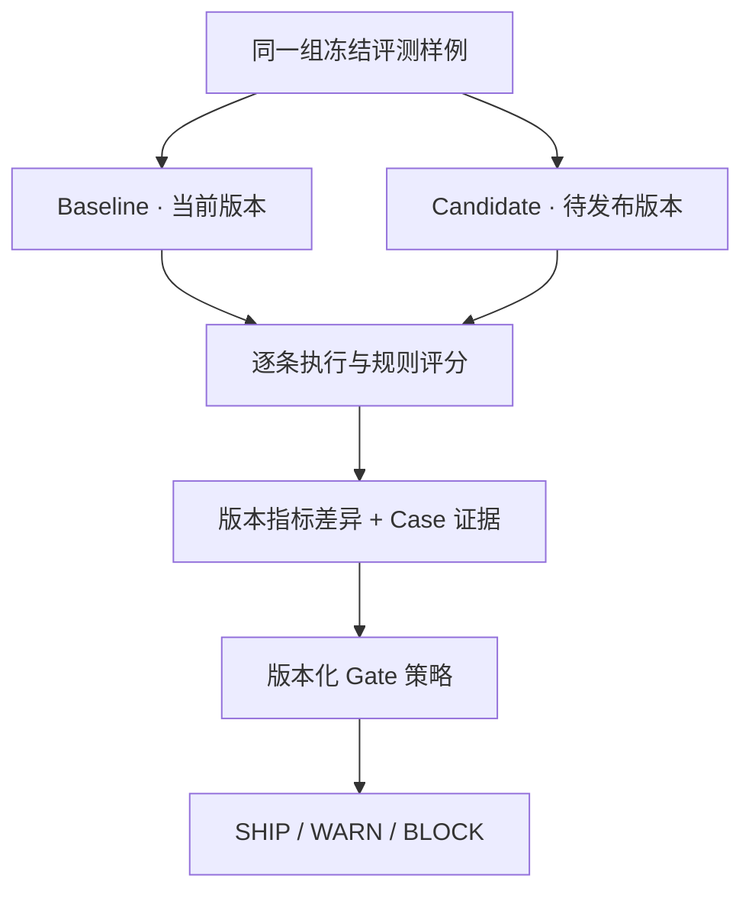

# Agent Quality Harness

[](https://github.com/xbzz1018/agent-quality-gate/actions/workflows/quality-gate.yml)

**为 Agent 版本变更提供可检查的发布依据。**

Agent Quality Harness（AQH）在同一组冻结样例上对比当前版本 Baseline 和待发布版本 Candidate，保留每条 Case 的规则结果与失败原因，再按质量、安全、延迟和成本策略给出 `SHIP / WARN / BLOCK`。它独立于被测 Agent 运行，适合需要反复做版本回归的开发者。

[第一次评测](docs/first-evaluation.md) · [项目案例与设计取舍](docs/project-case.md) · [运行手册](docs/runbook.md) · [实现与测试](docs/traceability.md)

## 什么时候用

| 你正在做的变更 | 用 AQH 检查什么 |
| --- | --- |
| 换模型或改提示词 | 同一批样例的成功率是否回退，哪些 Case 发生变化 |
| 调整工具调用或安全约束 | 工具参数是否符合规则，是否出现安全违规或目标执行错误 |
| 准备发布一个新版本 | 质量变化、P95 延迟和成本是否触发当前策略的警告或阻断条件 |

## 从样例到发布判断



一次版本对比运行包含 Baseline 和 Candidate，记录绑定数据哈希、版本、策略与价格快照。发现回退后，可以从指标进入 Case，检查输出、规则报告与事件；Candidate 存在失败 Case 时，可创建回放运行。

| Gate 结果 | 如何理解 |
| --- | --- |
| `SHIP` | 在本次样例和策略范围内满足发布条件 |
| `WARN` | 触发策略定义的警告，需要人工判断 |
| `BLOCK` | 触发阻断条件，例如执行失败、质量回退或策略引擎错误 |

`Completed` 表示运行结束，仍需查看 Case 与门禁原因。缺少 Baseline 时返回 `baseline_required`；用量或价格缺失时保留 `UNKNOWN`，要求费用预算的场景不能据此授权。

## 先跑一次 Demo

准备 Git、PowerShell 和 Docker Desktop（Linux 容器模式）。默认 Demo 使用本地 HTTP Fake Agent 和 80 条合成样例，无需真实模型 API Key。

**1. 获取代码，启动核心服务。** 以下命令在 Windows PowerShell 中执行：

```powershell
git clone https://github.com/xbzz1018/agent-quality-gate.git
cd agent-quality-gate
powershell -NoProfile -ExecutionPolicy Bypass -File scripts/start_closeout_stack.ps1 -Build
docker compose ps
```

等待 `api`、`worker`、`fake-agent` 和 `web` 等核心服务显示 `healthy`。启动脚本返回时，服务可能仍在初始化。

**2. 创建管理员并登录。** 平台没有默认密码。按[第一次评测指南](docs/first-evaluation.md)创建管理员，打开 <http://127.0.0.1:5174> 登录。

**3. 创建一次版本对比。** 在「被测目标」点击 **Demo Fixture**，再到「评测运行」点击 **创建运行**，选择 Demo 目标、冻结数据集、`baseline` / `candidate`、Demo 策略与价格快照。等待执行完成，依次查看 **版本对比 → Case 详情 → 查看门禁**。完整字段和排查步骤见[指南](docs/first-evaluation.md)。

Demo 初始化只创建配置，成绩由 Worker 实际执行后产生；合成样例的结果用于体验流程，不能代表真实 Agent 的质量。

## 接入自己的 Agent

用自己的 Target、版本和冻结样例替换 Demo 配置，保留同一套对比与门禁流程。HTTP、SSE、AG-UI、A2A、MCP 的适配和契约、Skills 与 Scenario 评测见[工程细节](docs/engineering-details.md)；开发环境、可选服务和检查命令见[运行手册](docs/runbook.md)。

默认核心栈由 Vue 控制台、FastAPI、PostgreSQL、Redis Worker、Inspect AI 和 OPA 组成。OpenTelemetry / Jaeger、协议 Fixture 和 Kafka 服务按需启用。

## 验证依据

| 材料 | 能说明什么 |
| --- | --- |
| Quality Gate CI | 后端规则与集成测试、迁移、依赖锁文件、Gate CLI，以及前端类型检查、测试与构建 |
| Demo Fixture | 本地合成样例的冻结、执行、评分、对比和门禁流程 |
| [历史目标记录](docs/current-target-verification.md) | 2026-08-26 服务快照中的 SHIP 与 BLOCK 案例；包含当时源码状态，不能当作当前版本成绩 |

当前项目面向受控本地评测。Kubernetes / 公网高可用尚未完成实际验收。

## 贡献与安全

参与前请阅读 [CONTRIBUTING.md](CONTRIBUTING.md) 和 [SECURITY.md](SECURITY.md)。公开材料使用合成 Fixture 或脱敏摘要，不提交凭据、私有原文与受限 Trace。
