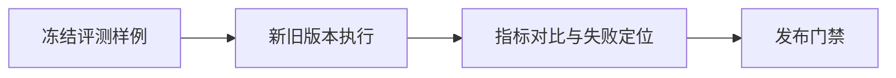

# Agent Quality Harness

[](https://github.com/xbzz1018/agent-quality-gate/actions/workflows/quality-gate.yml)

Agent Quality Harness（AQH）是一个 Agent 版本回归评测工具。更换模型、修改提示词或调整工具后，用同一批样例比较新旧版本，检查质量、延迟和成本变化，并定位失败原因。

[第一次评测](docs/first-evaluation.md) · [项目案例与设计取舍](docs/project-case.md) · [运行手册](docs/runbook.md) · [实现与测试](docs/traceability.md)

## 什么时候用

| 你正在做的变更 | 用 AQH 检查什么 |
| --- | --- |
| 换模型或改提示词 | 成功率是否回退，哪些样例的结果发生变化 |
| 调整工具调用或安全约束 | 工具参数是否符合规则，是否出现安全违规或目标执行错误 |
| 准备发布一个新版本 | 质量、P95 延迟和成本是否满足发布策略 |

## 从样例到发布判断



在一次运行中选择当前版本（Baseline）和待发布版本（Candidate），使用同一组冻结样例评测。发现回退后，可以查看具体样例的输出与规则结果，并回放失败样例。

| Gate 结果 | 如何理解 |
| --- | --- |
| `SHIP` | 满足所选策略的发布条件 |
| `WARN` | 触发策略定义的警告，需要人工判断 |
| `BLOCK` | 触发阻断规则，可查看具体原因 |

## 先跑一次 Demo

准备 Git、PowerShell 和 Docker Desktop（Linux 容器模式）。Demo 自带模拟 Agent 和 80 条合成样例，无需模型 API Key。

**1. 获取代码，启动核心服务。** 以下命令在 Windows PowerShell 中执行：

```powershell
git clone https://github.com/xbzz1018/agent-quality-gate.git
cd agent-quality-gate
powershell -NoProfile -ExecutionPolicy Bypass -File scripts/start_closeout_stack.ps1 -Build
docker compose ps
```

等待核心服务显示 `healthy`。

**2. 创建管理员并登录。** 按[第一次评测指南](docs/first-evaluation.md)创建管理员，打开 <http://127.0.0.1:5174> 登录。

**3. 创建一次版本对比。** 在「被测目标」点击 **Demo Fixture**，再到「评测运行」点击 **创建运行**。按[指南](docs/first-evaluation.md)选择 Demo 配置，执行后查看版本对比、样例详情和门禁结果。

## 接入自己的 Agent

注册被测服务、添加版本并导入评测样例，即可创建版本对比。支持 HTTP、SSE、AG-UI、A2A 和 MCP，协议配置见[工程细节](docs/engineering-details.md)。

技术栈：Vue、FastAPI、PostgreSQL、Redis Worker、Inspect AI、OPA。

开发与贡献：[运行手册](docs/runbook.md) · [实现与测试](docs/traceability.md) · [贡献指南](CONTRIBUTING.md) · [安全政策](SECURITY.md)

## 许可证

[MIT](LICENSE)
