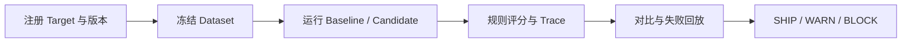

# Agent Quality Harness

[](https://github.com/xbzz1018/agent-quality-gate/actions/workflows/quality-gate.yml)

给 Agent 版本变更提供可检查的发布依据：在冻结数据上对比 Baseline / Candidate，定位失败 Case，结合质量、安全、延迟与成本规则给出 `SHIP / WARN / BLOCK`。

[项目案例](docs/project-case.md) · [本地运行](docs/runbook.md) · [实现与测试对应表](docs/traceability.md) · [工程细节](docs/engineering-details.md)

## 一次评测到发布决策



- **可追溯**：数据、版本、规则与运行记录绑定，运行前复核数据哈希。
- **可定位**：从版本差异进入 Case、规则结果与调用链，支持失败 Case 回放和取消。
- **可控制**：按策略比较质量与资源指标；安全规则和绑定的 OPA 策略参与最终门禁。

| 结果 | 含义 |
| --- | --- |
| SHIP | 在本次数据和策略范围内满足发布条件 |
| WARN | 存在策略定义的警告，需要人工判断 |
| BLOCK | 触发阻断条件，例如执行失败、质量回退或策略引擎错误 |

缺少 Baseline 时返回 `baseline_required`。Token 或成本未知时保留 UNKNOWN；要求费用预算的场景会据此拒绝授权。

## 本地体验

安装 Docker Desktop 和 PowerShell，从仓库根目录启动核心栈：

```powershell
powershell -NoProfile -ExecutionPolicy Bypass -File scripts/start_closeout_stack.ps1 -Build
"至少 12 位强密码" | docker compose exec -T api aqh admin bootstrap `
  --username admin --display-name "Platform Administrator" --password-stdin
```

打开 `http://127.0.0.1:5174`，初始化明确标记的 Demo Fixture，再实际运行 Baseline / Candidate，查看版本对比、Case、Trace 和 Gate。Fixture 使用 HTTP Fake Agent 与 80 条合成数据，不预填成绩。

依赖冲突、端口、Python 开发环境、完整检查命令与数据保留方式见[运行手册](docs/runbook.md)。

## 架构与验证范围

默认栈为 Vue、FastAPI、PostgreSQL、Redis Worker、Inspect AI 与 OPA。OpenTelemetry/Jaeger 及协议、Kafka 服务通过可选 profile 启用；平台与被测 Agent 分开部署。

| 验证材料 | 覆盖范围与限制 |
| --- | --- |
| Quality Gate CI | 后端规则与集成测试、迁移检查、Gate CLI、前端类型/测试/构建 |
| 合成 Fixture | 冻结数据、版本对比、证据映射和受控场景；不代表真实目标效果 |
| [历史目标记录](docs/current-target-verification.md) | 2026-08-26 的服务快照，包含真实 SHIP 与 BLOCK；不能证明不同提交间回归或当前版本效果 |
| Kubernetes / 公网高可用 | 未完成实际验收，不作为交付承诺 |

仓库展示的是受控本地评测与发布门禁。协议适配、Skills、Scenario 与版本历史见[工程细节](docs/engineering-details.md)；代码和验证入口见[对应表](docs/traceability.md)。

## 贡献与安全

请阅读 [CONTRIBUTING.md](CONTRIBUTING.md) 和 [SECURITY.md](SECURITY.md)。公开材料使用合成 Fixture 或脱敏摘要，不提交凭据、私有原文与受限 Trace。
